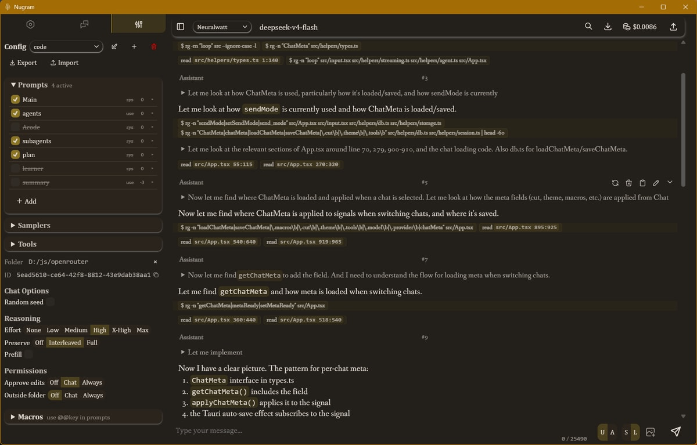
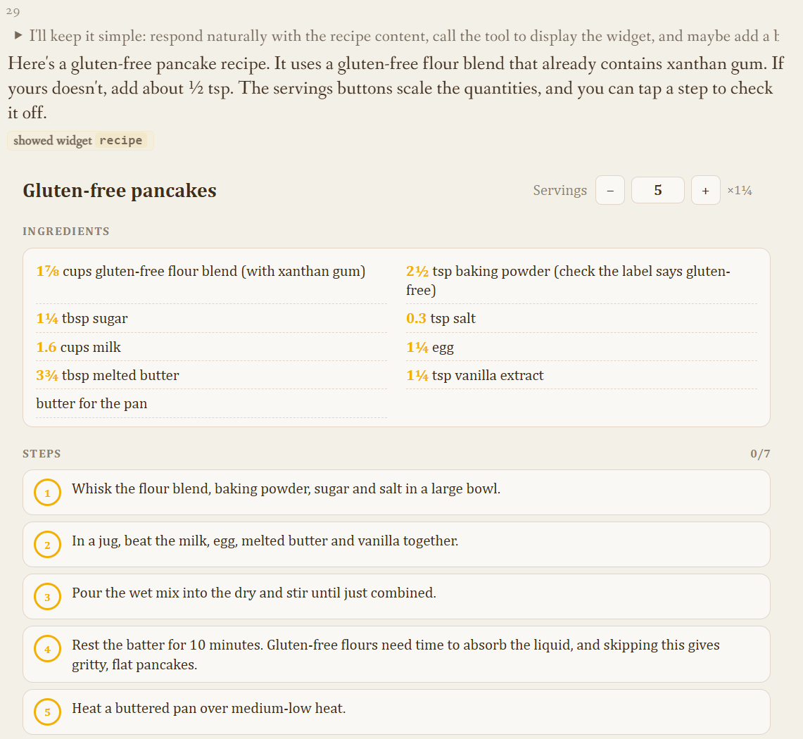
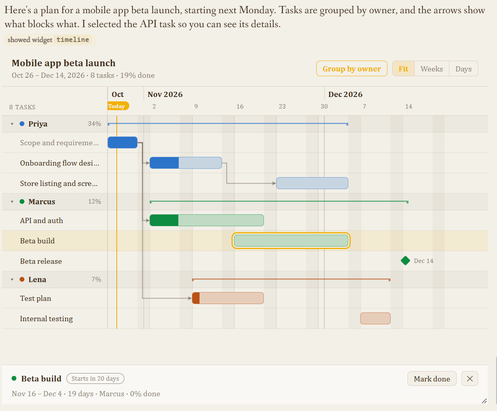

# Nugram



A Desktop and web app for LLM chat and Agentic Loops.

This product is under active development.

This project was built off of two frustrations with existing apps:
1. lack of control over what the LLM sees
2. lack of a nice gui for coding agents

Plus a bonus, while developing
3. bloated and inefficient context


**Lack of control over what the LLM sees:** Here's a little secret about LLM "chats". They're an illusion. Your "chat" is simply a nicely formatted document the LLM is asked to continue writing. Now, this "document" is fully controllable by the app. So why do most give you so little control, beyond sending a new message and regenerating the last one?

Nugram lets you regenerate, continue and edit any message in the chat, including the Assistant (AI)'s and tool calls. You can change history, gaslight the LLM or be the LLM.

**Lack of a nice gui for coding agents:** This has improved, but when the project started, Claude code, Codex, Pi, Opencode etc. were all just TUIs. I don't mind using the terminal, but TUI's feel like a regression of GUI tech by two decades. There's no accessibility, no proper text editing, no buttons or mouse usage.

**Bloated and inefficient context:** Many existing tools will waste tens of thousands of tokens on the system prompt and a dozen tools, and expect agents to burn a turn for every edit even when they know them all in advance.

## Features


- Providers: any OpenAI-compatible API (Chat Completions or Responses), plus dedicated support for OpenRouter, Z.ai, NanoGPT, Fireworks, Neuralwatt
- Message Versioning: track and navigate between multiple versions of messages
- Message Editing: edit the thinking, content and tool results of any message in the chat
- Chat Forking: fork a conversation at any message (an independent copy that remembers where it came from) or duplicate it whole
- Context Control: per-chat cut points that hide earlier messages from the model, and auto-compaction that summarizes and moves the cut during agent loops
- Request Control: per-model sampler overrides, and extra JSON body args matched by provider and model
- Tools: native tool calling with permission prompts. Web search and fetch everywhere; shell, file reading and multi-edit file editing (desktop). MCP support on roadmap
- run_js: based on Cloudflare's [Code Mode](https://blog.cloudflare.com/code-mode). The model writes JavaScript that calls the other tools as functions, so a batch of reads, edits or searches takes one turn instead of many. Globals persist per chat. An optional run_js-only mode has models do everything via writing scripts, which can be unexpectedly powerful
- Sub-agents (desktop): the model can spawn agents with their own tools, with configurable model tiers and per-config presets with their own tools, prompts, reasoning levels etc.
- Remote Backends (desktop): run shell and file tools on another machine over SSH
- Widgets (desktop): small local HTML apps the model can show inline in chat, sandboxed and following the app theme
- Lore System: a "Lorebook" for building a small searchable wiki with names, descriptions and content, which the model can read and edit through tools
- Themes: built-in themes (fantasy, scifi, modern) with light/dark variants. Custom themes and more control on roadmap
- Inline HTML: the web nature of the app means your LLMs can use HTML freely for advanced or stylized formatting (great for immersive stories)

<p>
	
	
</p>


## Getting Started
Requirements: `bun`, plus `cargo` for the desktop app.
```bash
git clone https://github.com/Tamnac/nugram.git
cd nugram
bun install

bun dev          # web dev server at localhost:3000
bun tauri dev    # desktop app with hot reload
bun test         # test suite

bun build        # static web build to dist/
bun tauri build  # desktop installer
```

Pushing a tag like `v0.2.0` makes GitHub Actions build the installers (`.github/workflows/release.yml`) and attach them to a draft release: `.msi` for Windows, `.deb` and `.AppImage` for Linux, `.dmg` for Apple Silicon Macs. Keep the tag in step with the version in `src-tauri/tauri.conf.json` and `Cargo.toml`.

**Platform support:** the app is developed and tested on Windows only. The Linux and macOS builds are untested and may have bugs or missing features. The macOS app is unsigned, so Gatekeeper will say it is damaged: run `xattr -cr /Applications/Nugram.app` once after installing, or right-click the app and choose Open.

Set provider keys and/or URLs in the sidebar. The app itself provides no LLM inference.
